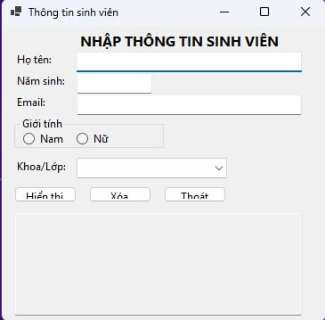
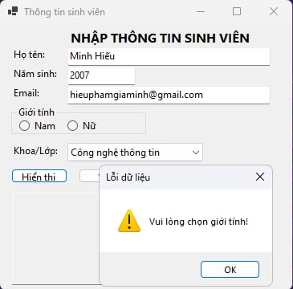
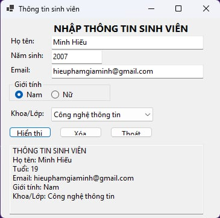
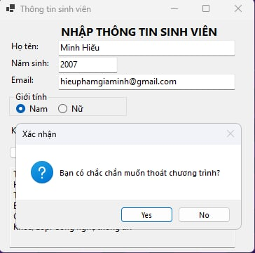

---

## 1. Mục tiêu bài thực hành
- Tạo project Windows Forms App cơ bản bằng C#.
- Thiết kế giao diện trực quan sử dụng các control cơ bản: `Label`, `TextBox`, `Button`, `RadioButton`, `ComboBox`, `GroupBox`.
- Xử lý sự kiện (Event Handling) cơ bản: Bắt sự kiện `Click` cho các nút bấm.
- Kiểm tra tính hợp lệ của dữ liệu đầu vào (Validation) trước khi xử lý.
- Hiển thị thông báo và kết quả cho người dùng (sử dụng `MessageBox` và `TextBox` multiline).

## 2. Mô tả ứng dụng
Ứng dụng là một Form đơn giản cho phép người dùng nhập thông tin cá nhân của sinh viên (Họ tên, Năm sinh, Email, Giới tính, Khoa/Lớp). Sau khi kiểm tra tính hợp lệ của các trường dữ liệu, chương trình sẽ tính toán tuổi và hiển thị bảng tổng hợp thông tin sinh viên lên màn hình.

## 3. Các chức năng chính và Kiểm tra dữ liệu
*   **Hiển thị thông tin:** Kiểm tra toàn bộ dữ liệu đầu vào. Nếu hợp lệ, tính toán "Tuổi" (Năm hiện tại - Năm sinh) và in kết quả ra màn hình.
*   **Kiểm tra dữ liệu (Validation):**
    *   *Họ tên, Email:* Không được để trống.
    *   *Năm sinh:* Không được để trống, phải là số nguyên, và phải nằm trong khoảng từ năm 1900 đến năm hiện tại.
    *   *Giới tính:* Bắt buộc phải chọn (Nam hoặc Nữ).
    *   *Khoa/Lớp:* Bắt buộc phải chọn từ danh sách có sẵn.
*   **Xóa dữ liệu:** Xóa toàn bộ dữ liệu đang nhập trên màn hình, đưa con trỏ chuột (focus) về lại ô "Họ tên".
*   **Thoát:** Hiển thị hộp thoại (`MessageBox`) xác nhận trước khi đóng chương trình để tránh thoát nhầm.

## 4. Mô tả kết quả & Hình ảnh minh họa

### 4.1. Giao diện chính của chương trình
Giao diện được thiết kế rõ ràng, chia theo từng dòng. Nút bấm được đặt ở dưới cùng và kết quả được hiển thị trong một TextBox lớn ở cuối form.



### 4.2. Xử lý bắt lỗi dữ liệu
Khi người dùng nhập thiếu dữ liệu (ví dụ để trống họ tên) hoặc nhập năm sinh không hợp lệ (ví dụ chứa chữ cái hoặc nằm ngoài khoảng 1900-năm hiện tại), chương trình sẽ hiển thị cảnh báo.



### 4.3. Kết quả hiển thị thành công
Khi nhập đầy đủ và đúng dữ liệu (VD: Nguyễn Văn A, 2005, vana@example.com, Nam, Công nghệ thông tin), chương trình xử lý và in ra đúng định dạng.



### 4.4. Chức năng Thoát
Hiển thị hộp thoại yêu cầu xác nhận `Yes/No` trước khi tắt form.



## 5. Hướng dẫn chạy chương trình
1. Clone repository này về máy.
2. Mở file `lab01.csproj` (hoặc `.sln` nếu có) bằng Visual Studio.
3. Nhấn `F5` hoặc nút **Start** để biên dịch và chạy ứng dụng.
```eof

