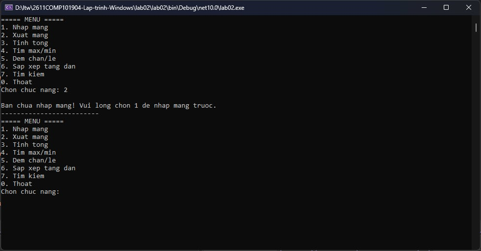
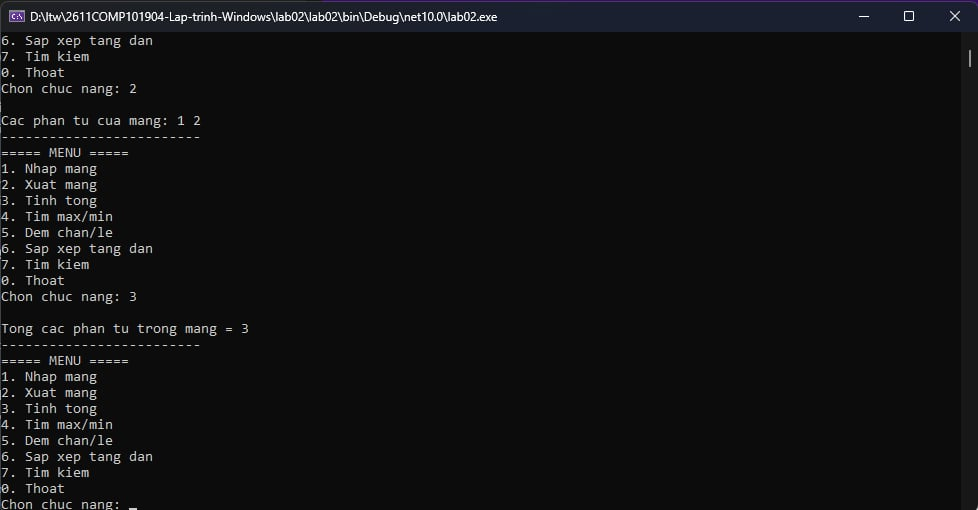
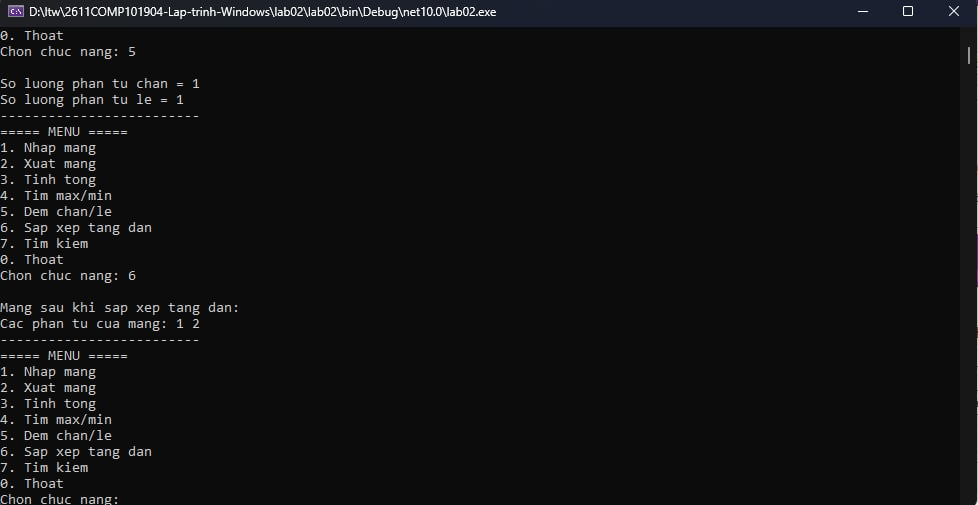
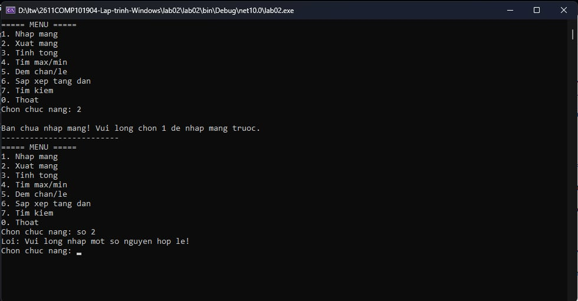

# Lab 02 - Quản lý mảng số nguyên (Console App)

**Môn học:** COMP1019 - Lập trình trên Windows  
**Buổi:** 2  

## 1. Mô tả dự án
Đây là một chương trình Console C# quản lý một mảng số nguyên. Chương trình cung cấp một menu tương tác cho phép người dùng thực hiện nhiều thao tác cơ bản trên mảng như nhập, xuất, tính toán (tổng, max, min), đếm số chẵn/lẻ, sắp xếp và tìm kiếm. 

Chương trình được thiết kế theo hướng module hóa, tách các chức năng thành các phương thức riêng biệt và có kiểm tra tính hợp lệ của dữ liệu đầu vào.

## 2. Mục tiêu đạt được
- Ôn lại và vận dụng cấu trúc chương trình C# Console.
- Sử dụng thành thạo biến, kiểu dữ liệu, toán tử, điều kiện và vòng lặp.
- Thao tác xử lý trên mảng một chiều.
- Phân chia logic chương trình thành các phương thức (`methods`) nhỏ gọn, dễ quản lý.
- Bắt lỗi và kiểm tra dữ liệu nhập (Validation) để tránh dừng chương trình đột ngột.

## 3. Các chức năng chính (Menu)
1. **Nhập mảng:** Cho phép nhập số lượng phần tử $n$ ($n > 0$) và các giá trị của mảng.
2. **Xuất mảng:** Hiển thị toàn bộ các phần tử đang có trong mảng.
3. **Tính tổng:** Tính và in ra tổng các phần tử trong mảng.
4. **Tìm max/min:** Tìm và hiển thị giá trị lớn nhất và nhỏ nhất.
5. **Đếm chẵn/lẻ:** Thống kê số lượng phần tử là số chẵn và số lẻ.
6. **Sắp xếp tăng dần:** Sắp xếp mảng theo thứ tự tăng dần và in kết quả.
7. **Tìm kiếm:** Nhập một giá trị $x$ và cho biết vị trí xuất hiện đầu tiên của $x$ trong mảng (nếu có).
0. **Thoát:** Kết thúc chương trình.

*Lưu ý: Các chức năng từ 2 đến 7 sẽ yêu cầu người dùng phải thực hiện chức năng 1 (Nhập mảng) trước. Nếu chưa nhập mảng, chương trình sẽ thông báo nhắc nhở.*

## 4. Dữ liệu kiểm thử (Test Cases)

Dưới đây là các trường hợp kiểm thử đã được thực hiện để đảm bảo tính đúng đắn của chương trình:

| STT | Dữ liệu nhập | Kết quả mong đợi |
|---|---|---|
| 1 | `n = 5`, mảng: `4 1 9 2 7` | Tổng = 23, max = 9, min = 1, chẵn = 2, lẻ = 3 |
| 2 | `n = 4`, mảng: `-3 0 8 -1` | Tổng = 4, max = 8, min = -3, chẵn = 2, lẻ = 2 |
| 3 | Tìm `x = 9` trong mảng `4 1 9 2 7` | Có tìm thấy, vị trí đầu tiên là 2 (tính từ 0) |
| 4 | Tìm `x = 5` trong mảng `4 1 9 2 7` | Không tìm thấy |
| 5 | Nhập `n = 0` hoặc `n` âm | Chương trình báo lỗi và yêu cầu nhập lại |
| 6 | Chọn menu khi chưa nhập mảng | Báo lỗi: "Ban chua nhap mang! Vui long chon 1..." |

## 5. Môi trường và Cách chạy chương trình
- **Framework:** .NET 10.0
- **Ngôn ngữ:** C#
- **IDE khuyên dùng:** Visual Studio 2022 hoặc Visual Studio Code.

**Cách chạy trên Terminal/Command Prompt:**
1. Clone repository này về máy.
2. Mở terminal tại thư mục chứa file `lab02.csproj`.
3. Chạy lệnh: `dotnet build` để biên dịch.
4. Chạy lệnh: `dotnet run` để bắt đầu chương trình.

## 6. Hình ảnh minh chứng (Screenshots)

**1. Hình ảnh hiển thị Menu và bắt lỗi chưa nhập mảng:**

**2. Hình ảnh nhập mảng và test case số 1 (Tổng, Max, Min, Chẵn, Lẻ):**

!(5.jpg)
!(6.jpg)

**3. Hình ảnh Sắp xếp và Tìm kiếm:**

!(8.jpg)

**4. Hình ảnh bắt lỗi nhập liệu (nhập chữ cái thay vì số, hoặc n <= 0):**
