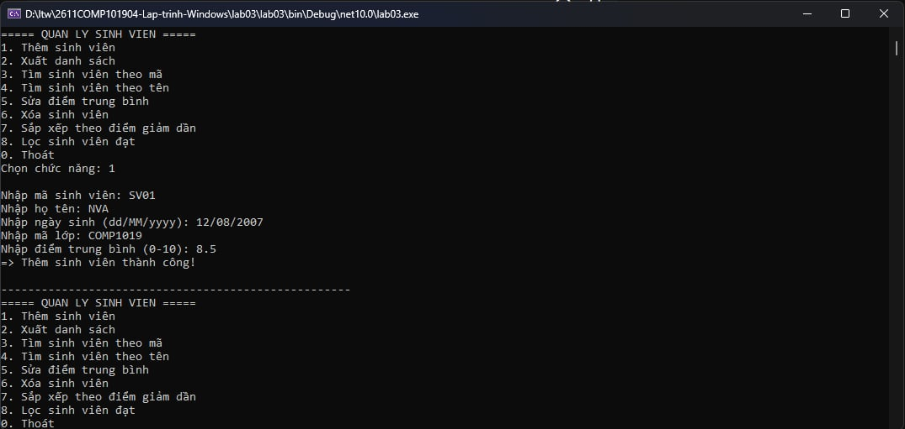
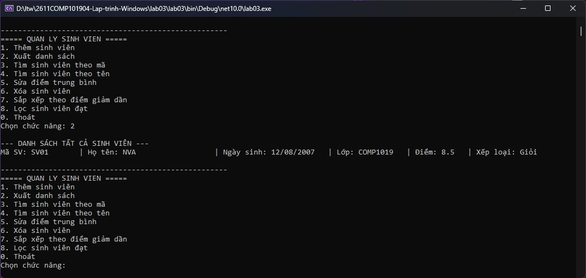

# Lab 03 - Quản Lý Sinh Viên (C# OOP)

Đây là dự án ứng dụng Console quản lý danh sách sinh viên được viết bằng C#. Ứng dụng áp dụng triệt để các nguyên lý Lập trình hướng đối tượng (OOP) như tính kế thừa, đóng gói, cũng như sử dụng các cấu trúc dữ liệu và công cụ truy vấn hiện đại của C# (List, LINQ).

Mục tiêu Lab đã hoàn thành

Dự án này đã đáp ứng đầy đủ các tiêu chí kỹ thuật và mục tiêu học tập được đề ra:

- **Vận dụng OOP:** Sử dụng thành thạo `class`, `object`, `property` và `constructor`.
- **Tính kế thừa (Inheritance):** Lớp `SinhVien` kế thừa trực tiếp từ lớp cơ sở `Nguoi`. Ghi đè (override) phương thức `LayThongTin()`.
- **Đóng gói & Kiểm tra dữ liệu (Encapsulation):** Thuộc tính `DiemTrungBinh` của sinh viên được kiểm soát chặt chẽ, chỉ cho phép nhận giá trị từ `0.0` đến `10.0`. Ném ra ngoại lệ (`ArgumentException`) nếu dữ liệu không hợp lệ.
- **Quản lý bộ nhớ:** Sử dụng `List<SinhVien>` để lưu trữ và quản lý dữ liệu linh hoạt.
- **Tách biệt logic (Separation of Concerns):** Code không bị gom chung vào hàm `Main`. Chương trình được chia thành các class chuyên biệt (`Nguoi`, `SinhVien`, `QuanLySinhVien`) với nhiệm vụ rõ ràng.
- **Sử dụng LINQ:** Ứng dụng LINQ trong các nghiệp vụ Tìm kiếm theo tên (`Where`), Tìm theo mã (`FirstOrDefault`), Sắp xếp (`OrderByDescending`) và Lọc dữ liệu.
- **Xử lý ngoại lệ (Exception Handling):** Bắt lỗi nhập liệu từ người dùng (chữ thay vì số, sai định dạng ngày tháng) bằng `TryParse` và vòng lặp, đảm bảo chương trình không bị crash (dừng đột ngột).
- **Chuẩn coding convention:** Sử dụng chuẩn `PascalCase` cho tên Class, Property, Method.

Cấu trúc dự án

Dự án được chia thành 4 file `.cs` chính, tuân thủ mô hình phân lớp cơ bản:

- `Nguoi.cs`: Class cha chứa các thông tin cơ bản của một người (Họ tên, Ngày sinh) và phương thức in thông tin virtual.
- `SinhVien.cs`: Class con kế thừa từ `Nguoi`, bổ sung thêm Mã SV, Mã lớp, Điểm TB. Xử lý logic xếp loại học lực và kiểm tra tính hợp lệ của điểm số.
- `QuanLySinhVien.cs`: Class Service chuyên đảm nhận các nghiệp vụ xử lý danh sách (CRUD, tìm kiếm, lọc, sắp xếp) bằng danh sách `List<SinhVien>` và LINQ.
- `Program.cs`: Lớp giao diện (UI) điều khiển luồng chương trình, hiển thị Menu, tiếp nhận input từ người dùng và gọi các hàm từ `QuanLySinhVien` để thực thi.

Các chức năng chính

Chương trình cung cấp menu tương tác với các lựa chọn sau:

1. **Thêm sinh viên:** Nhập thông tin sinh viên mới. Tự động chặn nếu trùng `Mã sinh viên` hoặc sai khoảng điểm.
2. **Xuất danh sách:** Hiển thị toàn bộ sinh viên đang có trong hệ thống.
3. **Tìm sinh viên theo mã:** Trả về thông tin chi tiết của 1 sinh viên duy nhất khớp mã.
4. **Tìm sinh viên theo tên:** Trả về danh sách các sinh viên có chứa từ khóa tên vừa nhập (không phân biệt hoa thường).
5. **Sửa điểm trung bình:** Cập nhật lại điểm cho sinh viên dựa vào mã.
6. **Xóa sinh viên:** Xóa hoàn toàn một sinh viên khỏi hệ thống bằng mã.
7. **Sắp xếp theo điểm giảm dần:** In danh sách từ điểm cao nhất đến thấp nhất.
8. **Lọc sinh viên đạt:** Hiển thị danh sách các sinh viên có điểm trung bình >= 5.0.
0. **Thoát chương trình.**

