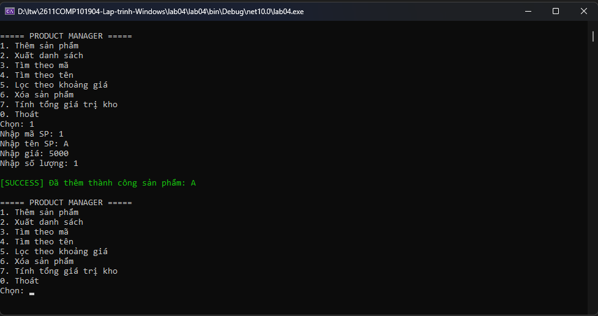
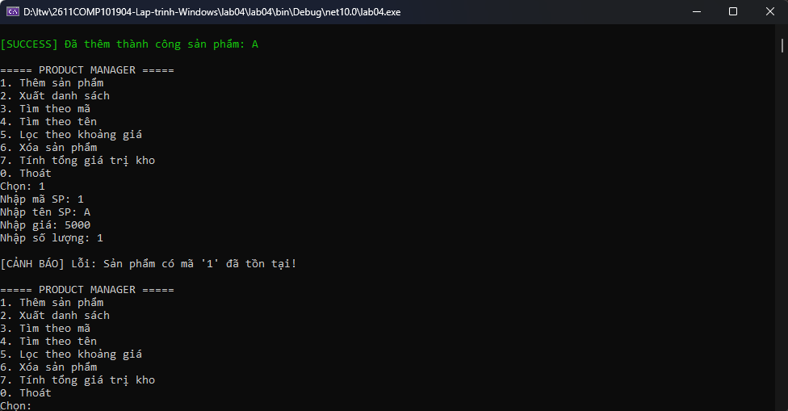
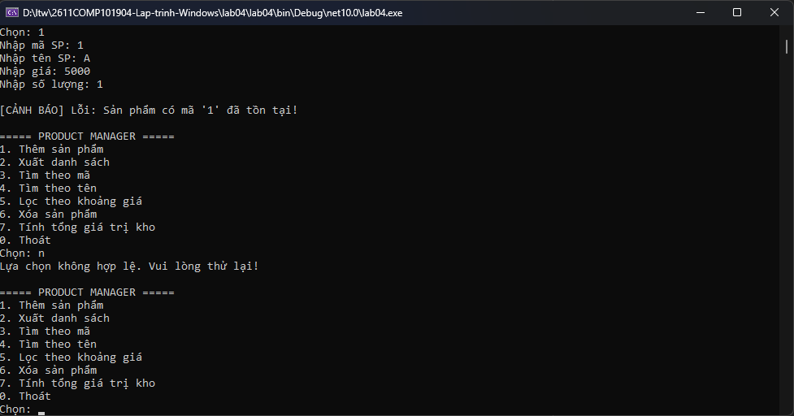
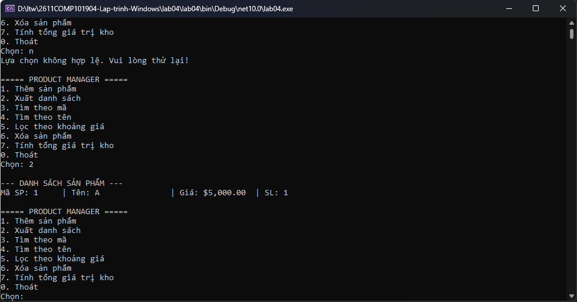

# Lab 04 - Quản lý Sản phẩm (Console App)

**Môn học:** COMP1019 - Lập trình trên Windows  
**Buổi:** 4  

## 1. Mô tả dự án
Đây là một chương trình Console C# quản lý danh sách sản phẩm. Chương trình cho phép người dùng thực hiện các thao tác quản lý kho hàng cơ bản (thêm, xuất, tìm kiếm, xóa, lọc và tính tổng giá trị) thông qua một menu tương tác.

Điểm nổi bật của dự án là việc áp dụng các kỹ thuật lập trình hướng đối tượng nâng cao: dữ liệu được lưu trong bộ nhớ thông qua một lớp Generic (`Repository<T>`), các lỗi nhập liệu hoặc lỗi nghiệp vụ (như trùng mã, không tìm thấy sản phẩm) được xử lý gọn gàng bằng các Custom Exception, và kiến trúc chương trình được tách bạch rõ ràng giữa phần xử lý logic (`ProductService`) và phần giao diện người dùng (`Program`).

## 2. Mục tiêu đạt được
- Vận dụng `try-catch`, `throw` và tự định nghĩa Exception (`DuplicateProductException`, `ProductNotFoundException`) để xử lý lỗi chương trình.
- Sử dụng `Delegate`/`Event` (cụ thể là `Action<string>`) để thông báo khi có sự thay đổi dữ liệu (thêm, xóa thành công).
- Sử dụng `Func<T, bool>` kết hợp LINQ để linh hoạt lọc và tìm kiếm dữ liệu.
- Xây dựng lớp Generic `Repository<T>` với ràng buộc `where T : IEntity` để tái sử dụng mã nguồn.
- Tổ chức code theo hướng phân lớp (Clean Code), không viết toàn bộ xử lý dồn vào hàm `Main`.

## 3. Các chức năng chính (Menu)
1. **Thêm sản phẩm:** Nhập mã, tên, đơn giá và số lượng. Hệ thống sẽ kiểm tra mã không rỗng, giá/số lượng không âm và mã không bị trùng lặp.
2. **Xuất danh sách:** Hiển thị toàn bộ thông tin sản phẩm đang có trong kho.
3. **Tìm theo mã:** Nhập một mã sản phẩm và hiển thị thông tin chi tiết nếu tồn tại.
4. **Tìm theo tên:** Nhập từ khóa và hệ thống sẽ liệt kê các sản phẩm có tên chứa từ khóa đó (không phân biệt hoa thường).
5. **Lọc theo khoảng giá:** Nhập mức giá thấp nhất và cao nhất để xem các sản phẩm phù hợp.
6. **Xóa sản phẩm:** Nhập mã sản phẩm để xóa. Nếu xóa thành công, hệ thống sẽ phát tín hiệu (Event) thông báo.
7. **Tính tổng giá trị kho:** Tự động tính toán tổng số tiền (Đơn giá $\times$ Số lượng) của toàn bộ hàng hóa.
0. **Thoát:** Kết thúc phiên làm việc.

## 4. Dữ liệu kiểm thử (Test Cases)

Dưới đây là các trường hợp kiểm thử để đảm bảo tính đúng đắn và khả năng chịu lỗi của chương trình:

| STT | Dữ liệu nhập / Thao tác | Kết quả mong đợi |
|---|---|---|
| 1 | Nhập SP: Mã `SP01`, Tên `Laptop`, Giá `1500`, SL `2` | Thêm thành công, Console in dòng chữ xanh: `[SUCCESS] Đã thêm thành công...` |
| 2 | Nhập SP: Mã `SP01`, Tên `Chuột`, Giá `100`, SL `5` | Báo lỗi cảnh báo: `Lỗi: Sản phẩm có mã 'SP01' đã tồn tại!` |
| 3 | Nhập SP: Mã `SP02`, Giá `-50` hoặc SL `-5` | Báo lỗi dữ liệu: `Đơn giá không được âm.` hoặc `Số lượng không được âm.` |
| 4 | Tìm kiếm theo tên: Từ khóa `lap` | Trả về thông tin của sản phẩm `Laptop` (SP01). |
| 5 | Lọc theo giá: Min `1000`, Max `2000` | Liệt kê `SP01` (vì giá là 1500, nằm trong khoảng). |
| 6 | Tính tổng giá trị kho (chỉ có SP01) | Thông báo: `=> Tổng giá trị kho: $3,000.00` (1500 $\times$ 2). |
| 7 | Xóa sản phẩm mã `SP99` (Không tồn tại) | Báo lỗi: `Lỗi: Không tìm thấy sản phẩm có mã 'SP99' để xóa!` |

## 5. Môi trường và Cách chạy chương trình
- **Framework:** .NET 10.0
- **Ngôn ngữ:** C#
- **IDE khuyên dùng:** Visual Studio 2022 hoặc Visual Studio Code.

**Cách chạy trên Terminal/Command Prompt:**
1. Clone hoặc tải mã nguồn về máy.
2. Mở terminal tại thư mục chứa file `lab04.csproj`.
3. Chạy lệnh: `dotnet build` để biên dịch (tùy chọn).
4. Chạy lệnh: `dotnet run` để bắt đầu chương trình.

## 6. Hình ảnh minh chứng (Screenshots)

**1. Hình ảnh hiển thị Menu và Thêm sản phẩm thành công :**

**2. Hình ảnh bắt lỗi thêm sản phẩm trùng mã, sai giá trị âm :**

**3. Hình ảnh Xuất danh sách và Lọc sản phẩm theo giá, tên :**

