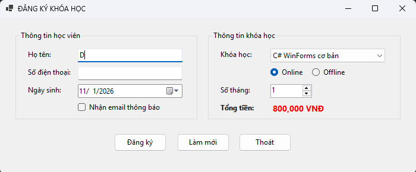
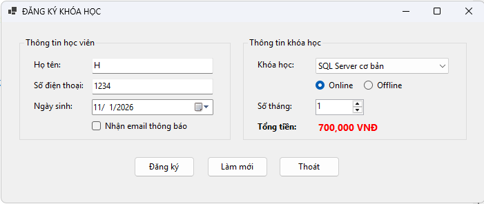
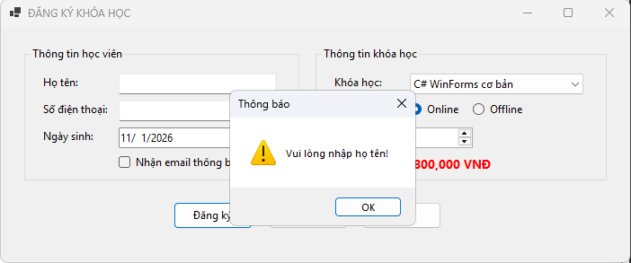
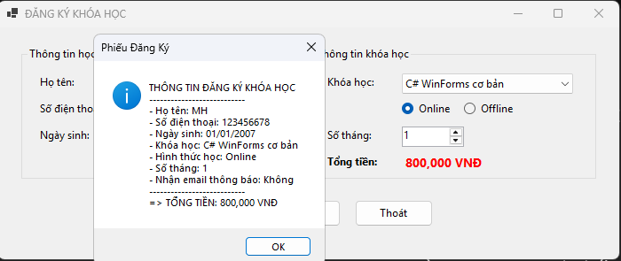
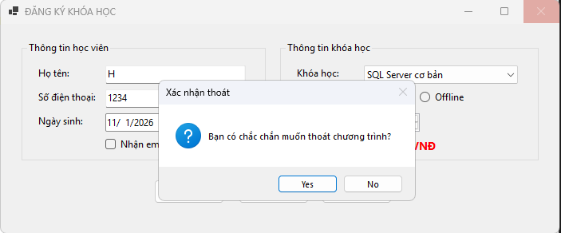

# Báo cáo Lab 5: Ứng dụng Đăng Ký Khóa Học (Course Registration App)

**Môn học:** Lập trình trên Windows (COMP1019)  
**Nền tảng:** C# Windows Forms (.NET 10.0)  

---

## 1. Giới thiệu
**CourseRegistrationApp** là một ứng dụng Desktop cơ bản được xây dựng bằng Windows Forms (C#). Ứng dụng mô phỏng quy trình thu thập thông tin và đăng ký khóa học của học viên tại một trung tâm tin học, hỗ trợ tính toán tổng học phí tự động và kiểm tra tính hợp lệ của dữ liệu đầu vào.

## 2. Mục tiêu đạt được
Thông qua project này, các mục tiêu kỹ thuật sau đã được hoàn thành:
- Khởi tạo thành công project Windows Forms App bằng C#.
- Thiết kế giao diện trực quan bằng Form Designer với việc kết hợp linh hoạt các controls: `Label`, `TextBox`, `Button`, `ComboBox`, `RadioButton`, `CheckBox`, `DateTimePicker`, `NumericUpDown`, `GroupBox`.
- Đặt tên control chuẩn quy ước (VD: `txtHoTen`, `btnDangKy`, `cboKhoaHoc`,...) giúp code mạch lạc và dễ bảo trì.
- Lắng nghe và xử lý tốt các sự kiện: `Load`, `Click`, `SelectedIndexChanged`, `ValueChanged`, `FormClosing`.
- Xử lý nghiệp vụ: Validate dữ liệu form trống, tính toán chi phí tự động và hiển thị phản hồi người dùng bằng `MessageBox`.

---

## 3. Các chức năng chính

### Khởi tạo mặc định (Form Load)
- Nạp danh sách 4 khóa học có sẵn (C#, SQL Server, Web Frontend, Python) vào `ComboBox`.
- Thiết lập tự động chọn khóa học đầu tiên và hình thức học mặc định là "Online".
- Số tháng học giới hạn từ 1 đến 12 tháng (mặc định là 1).
- Tính toán và hiển thị ngay tổng học phí ban đầu.

### Nút Đăng Ký (btnDangKy)
- **Kiểm tra dữ liệu (Validation):** Yêu cầu nhập đầy đủ Họ tên, Số điện thoại và phải chọn Khóa học. Con trỏ chuột tự động focus về các ô còn thiếu.
- **Tính toán:** `Tổng tiền = Học phí 1 tháng × Số tháng đăng ký`.
- **Báo cáo:** Hiển thị một `MessageBox` (Phiếu Đăng Ký) tóm tắt toàn bộ thông tin đăng ký của học viên một cách rõ ràng.

### Tự động tính học phí (Auto-calculate)
- Sự kiện `SelectedIndexChanged` trên ComboBox và `ValueChanged` trên NumericUpDown được gắn chung logic để tự động cập nhật số tiền hiển thị ở nhãn "Tổng tiền" ngay khi người dùng thay đổi lựa chọn.

### Nút Làm Mới (btnLamMoi)
- Xóa sạch dữ liệu nhập liệu (Họ tên, SĐT).
- Khôi phục ngày sinh về ngày hiện tại.
- Đưa các lựa chọn về trạng thái mặc định (Khóa học đầu tiên, Online, 1 tháng, không nhận email).
- Đưa con trỏ nhấp nháy về lại ô Họ tên để nhập mới.

### Nút Thoát & Đóng Form (btnThoat & FormClosing)
- Bắt sự kiện click nút Thoát và cả thao tác bấm dấu "X" trên góc Form.
- Hiển thị hộp thoại xác nhận (Yes/No). Chương trình chỉ đóng lại nếu người dùng thực sự chọn Yes.

---

## 4. Cấu trúc Project
- `Program.cs`: Entry point của ứng dụng.
- `KhoaHoc.cs (Class1.cs)`: Class định nghĩa đối tượng Khóa học gồm thuộc tính Tên khóa học và Học phí. Có override `ToString()` để hiển thị đẹp trên ComboBox.
- `Form1.cs`: Chứa toàn bộ logic xử lý sự kiện (Event Handlers) và kiểm tra dữ liệu.
- `Form1.Designer.cs`: Mã auto-generated chứa cấu trúc giao diện ứng dụng.

---

## 5. Hình ảnh minh họa (Screenshots)

*(Sinh viên thay thế các link ảnh dưới đây bằng hình chụp thực tế của màn hình ứng dụng)*

**1. Giao diện chính khi vừa khởi động:**

**2. Giao diện khi thay đổi lựa chọn khóa học/số tháng (Tiền cập nhật tự động):**

**3. Bắt lỗi khi để trống Họ tên hoặc SĐT:**

**4. Phiếu thông báo đăng ký thành công:**

**5. Hộp thoại xác nhận khi bấm thoát:**
