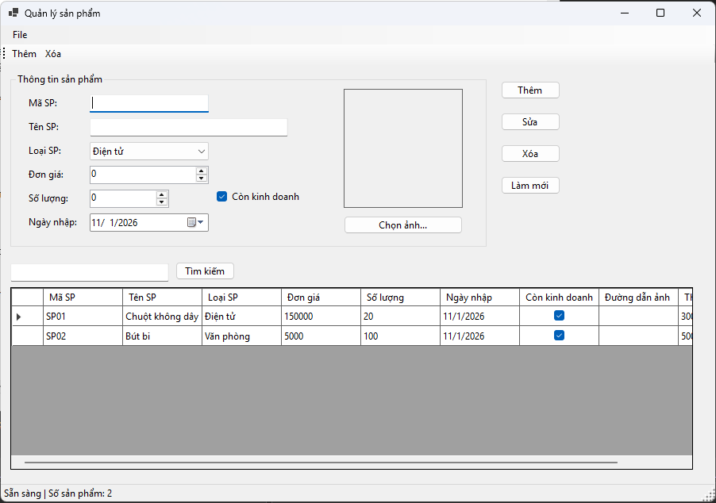
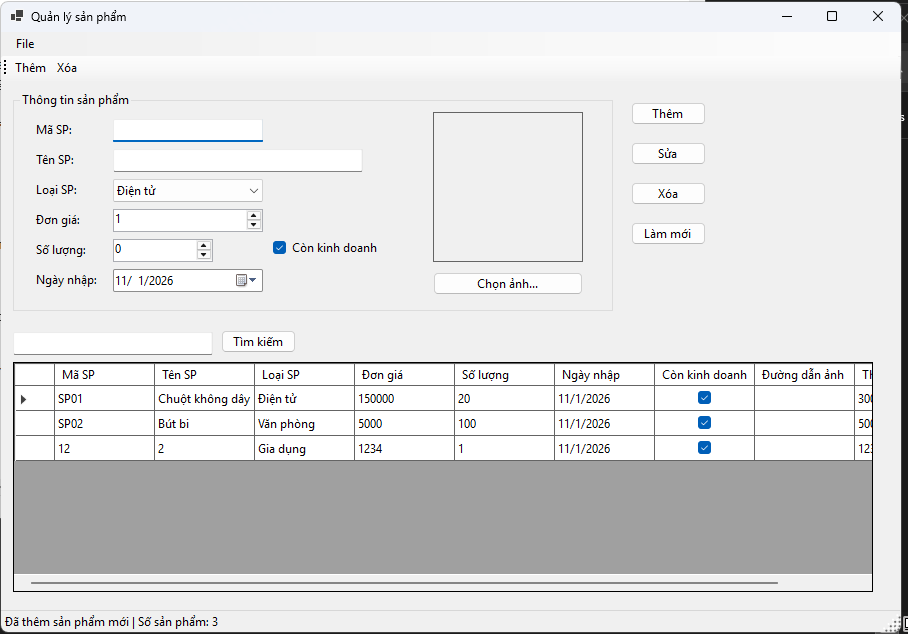
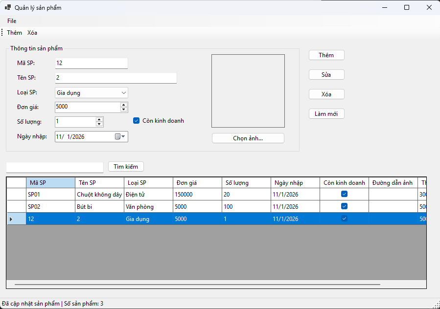
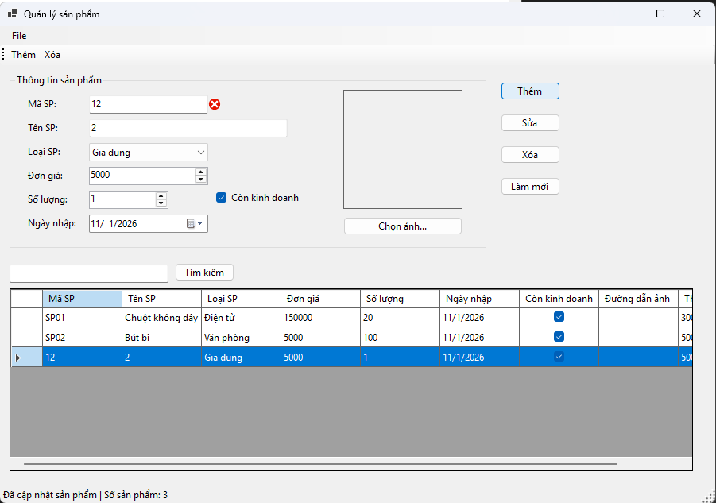
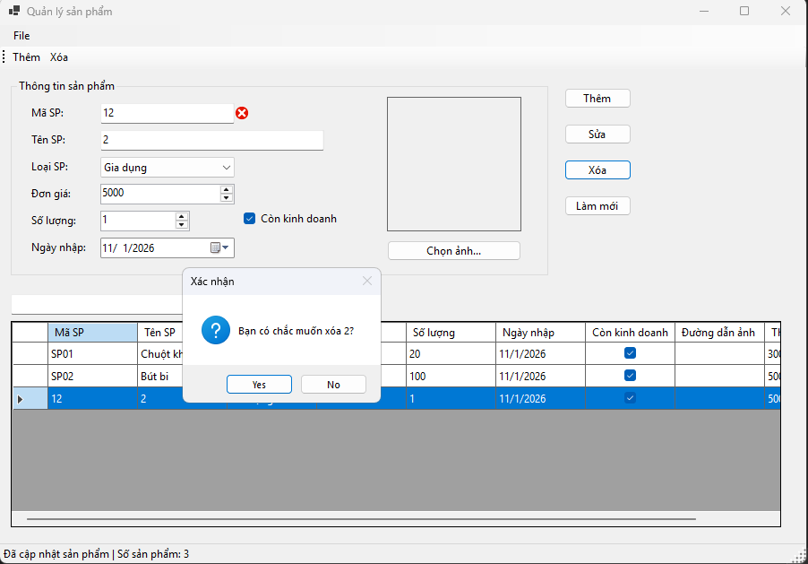

# Lab 06 - Quản lý sản phẩm (Windows Forms App)

**Môn học:** COMP1019 - Lập trình trên Windows  
**Buổi:** 6  

## 1. Mô tả dự án
Đây là một ứng dụng Desktop được xây dựng bằng C# Windows Forms quản lý danh sách sản phẩm. Chương trình cung cấp giao diện trực quan cho phép người dùng thực hiện các thao tác quản lý cơ bản (CRUD) như thêm, sửa, xóa, tìm kiếm thông tin sản phẩm và quản lý hình ảnh minh họa.

Chương trình được thiết kế theo hướng quản lý đối tượng (`Product`), sử dụng cơ chế Data Binding (`BindingList`, `BindingSource`) để đồng bộ dữ liệu với giao diện (`DataGridView`), đồng thời tích hợp kiểm tra dữ liệu đầu vào (Validation) chặt chẽ bằng `ErrorProvider`.

## 2. Mục tiêu đạt được
- Thiết kế và xây dựng giao diện ứng dụng Windows Forms cơ bản.
- Thao tác thành thạo với các điều khiển (Controls): `TextBox`, `ComboBox`, `NumericUpDown`, `DateTimePicker`, `PictureBox`, `DataGridView`...
- Sử dụng `BindingList<T>` và `BindingSource` để hiển thị và đồng bộ dữ liệu.
- Xử lý các sự kiện (Events) của người dùng như Click nút, chọn dòng trên lưới dữ liệu.
- Bắt lỗi và kiểm tra dữ liệu nhập liệu (Validation) với `ErrorProvider` để tránh sai sót dữ liệu.
- Thao tác với hộp thoại hệ thống `OpenFileDialog` để chọn và tải hình ảnh.

## 3. Các chức năng chính (Menu/Giao diện)
1. **Thêm sản phẩm:** Nhập thông tin chi tiết và thêm sản phẩm mới vào danh sách. Không cho phép trùng Mã SP.
2. **Sửa sản phẩm:** Cập nhật thông tin của sản phẩm đang được chọn trên lưới.
3. **Xóa sản phẩm:** Xóa sản phẩm đang chọn sau khi hiển thị hộp thoại xác nhận (Yes/No).
4. **Tìm kiếm:** Lọc danh sách sản phẩm theo *Mã sản phẩm* hoặc *Tên sản phẩm*.
5. **Làm mới (Clear):** Xóa trắng các trường nhập liệu, thiết lập lại trạng thái ban đầu và hủy bỏ bộ lọc tìm kiếm.
6. **Chọn ảnh:** Cho phép người dùng duyệt file trên máy tính và hiển thị ảnh sản phẩm.
7. **Tính toán tự động:** Tự động tính trường Thành tiền (Đơn giá * Số lượng).
8. **Tiện ích mở rộng:** Hỗ trợ ToolStrip (Truy cập nhanh Thêm, Xóa) và ContextMenuStrip (Click chuột phải trên lưới để Sửa, Xóa, Xem chi tiết).

## 4. Dữ liệu kiểm thử (Test Cases)

Dưới đây là các trường hợp kiểm thử đã được thực hiện để đảm bảo tính đúng đắn của chương trình:

| STT | Thao tác kiểm thử | Dữ liệu nhập / Điều kiện | Kết quả mong đợi |
|---|---|---|---|
| 1 | Thêm sản phẩm hợp lệ | Mã: `SP03`, Tên: `Bàn phím`, Giá: `200000`, SL: `2` | Thêm thành công, hiển thị trên lưới, Thành tiền = 400,000 |
| 2 | Bắt lỗi rỗng dữ liệu | Để trống `Mã SP` hoặc `Tên SP` rồi bấm Thêm | Hiển thị icon đỏ báo lỗi "Mã SP/Tên SP không được rỗng" |
| 3 | Bắt lỗi trùng Mã SP | Nhập Mã SP là `SP01` (đã có sẵn) rồi bấm Thêm | Báo lỗi "Mã sản phẩm đã tồn tại" ngay tại ô Mã SP |
| 4 | Bắt lỗi Đơn giá/Ngày nhập | Đơn giá = 0 hoặc Ngày nhập > Hôm nay | Báo lỗi "Đơn giá phải > 0" hoặc "Ngày không lớn hơn hôm nay" |
| 5 | Xóa sản phẩm | Chọn `SP02`, bấm Xóa | Bật hộp thoại hỏi "Bạn có chắc muốn xóa Bút bi?". Nếu Yes -> Bị xóa. |
| 6 | Tìm kiếm | Nhập `chuột` vào ô tìm kiếm, bấm Tìm kiếm | Lưới dữ liệu chỉ hiển thị `SP01` (Chuột không dây) |
| 7 | Xem chi tiết | Click chuột phải vào `SP01` -> Xem chi tiết | Bật MessageBox hiển thị chi tiết: Mã, Tên, Loại, Tổng tiền |

## 5. Môi trường và Cách chạy chương trình
- **Framework:** .NET 10.0
- **Ngôn ngữ:** C#
- **IDE khuyên dùng:** Visual Studio 2022.

**Cách chạy:**
1. Clone repository này về máy hoặc giải nén thư mục source code.
2. Click đúp vào file `lab06.csproj` để mở dự án trong Visual Studio.
3. Nhấn phím `F5` hoặc bấm nút **Start** để biên dịch và chạy chương trình.
4. *(Hoặc chạy bằng lệnh CLI)*: Mở terminal tại thư mục chứa file `.csproj` và gõ lệnh `dotnet run`.

## 6. Hình ảnh minh chứng (Screenshots)

**1. Hình ảnh Giao diện chính và hiển thị dữ liệu mặc định:**

**2. Hình ảnh thêm hình ảnh sản phẩm và tính năng Thêm/Sửa:**

**3. Hình ảnh bắt lỗi dữ liệu (ErrorProvider Validation):**

**4. Hình ảnh Menu chuột phải (Context Menu) và Hộp thoại xác nhận xóa:**

