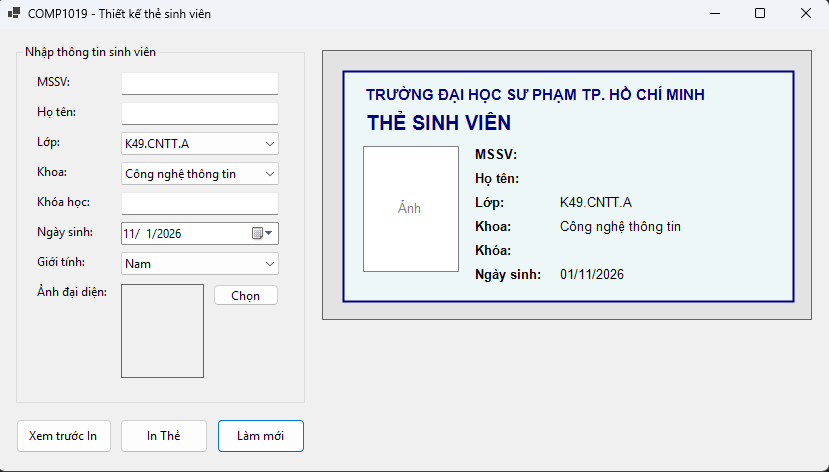
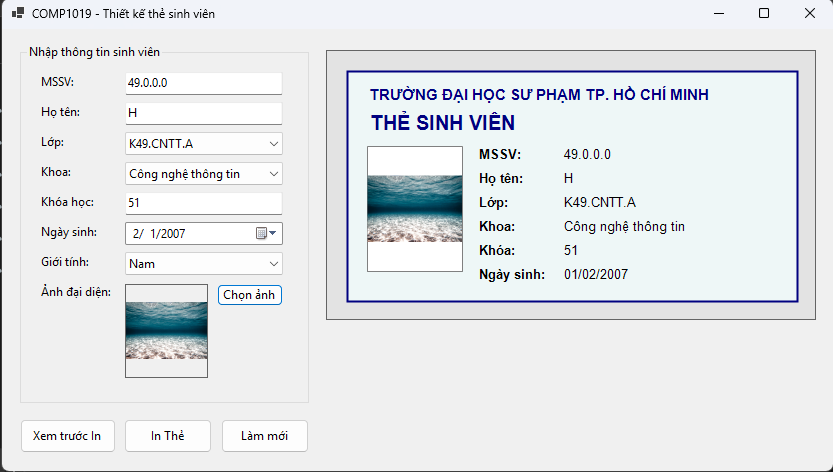
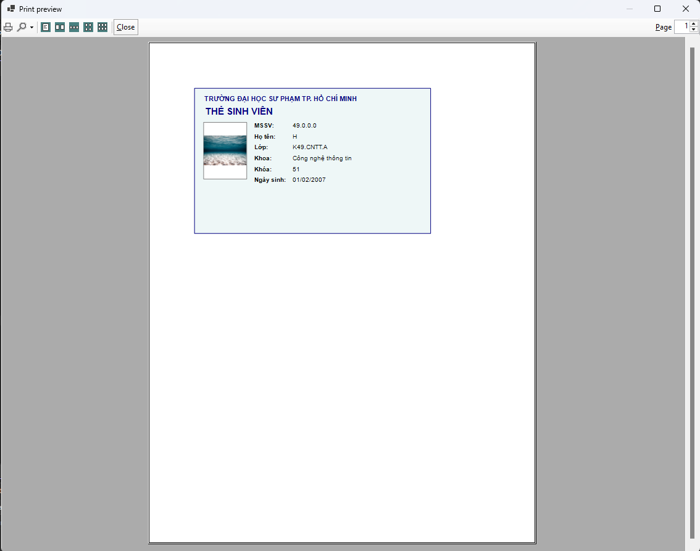

# COMP1019 - Ứng dụng Thiết kế và In Thẻ Sinh Viên

## Giới thiệu
Dự án này là một ứng dụng Windows Forms (C# - .NET) cho phép người dùng nhập thông tin sinh viên, tải lên ảnh đại diện, xem trước trực tiếp (Live Preview) thiết kế thẻ sinh viên bằng công nghệ vẽ **GDI+** và thực hiện in ấn thẻ sinh viên thực tế thông qua `PrintDocument`.

Ứng dụng được tổ chức code rõ ràng, tích hợp đầy đủ tính năng kiểm tra dữ liệu đầu vào (Validation) và xử lý ảnh mượt mà, đảm bảo ảnh không bị méo và không bị khóa file khi đổi ảnh mới.

## Các tính năng chính (Features)
*   **F1 - Chọn ảnh**: Hỗ trợ chọn file định dạng `JPG`, `PNG`, `BMP`. Ảnh tự động căn chỉnh (Zoom) đúng tỉ lệ.
*   **F2 - Preview thẻ**: Vẽ lại thẻ sinh viên real-time trên `Panel` mỗi khi người dùng thay đổi bất kỳ thông tin nào (GDI+).
*   **F3 - Validation**: Chặn thao tác xem trước in và in nếu người dùng chưa nhập đủ thông tin bắt buộc (MSSV, Họ tên, Ảnh đại diện).
*   **F4 & F5 - In và Xem trước bản in**: Tích hợp `PrintPreviewDialog` để kiểm tra bản in và `PrintDialog` để chọn máy in trước khi xuất bản thật.
*   **F6 - Làm mới**: Reset toàn bộ form về trạng thái mặc định ban đầu.

## Hướng dẫn cài đặt và chạy chương trình
1. Yêu cầu hệ thống: Cài đặt sẵn .NET SDK (phiên bản .NET 6.0 trở lên) và Visual Studio 2022.
2. Clone repository hoặc tải mã nguồn về máy.
3. Mở file `lab09.csproj` bằng Visual Studio.
4. Nhấn **F5** hoặc nút **Start** để biên dịch và chạy chương trình.
5. Nhập thông tin, bấm "Chọn ảnh" để tải ảnh lên và kiểm tra giao diện thẻ ở Panel bên phải.
6. Bấm "Xem trước In" để kiểm tra bố cục trang in.

## Danh sách Test Case đã kiểm thử

| Mã TC | Tên Test Case | Dữ liệu đầu vào / Thao tác | Kết quả mong đợi | Kết quả thực tế |
| :---: | :--- | :--- | :--- | :--- |
| **TC01** | Bỏ trống MSSV | Để trống ô MSSV, bấm "In Thẻ" | Hiện thông báo lỗi yêu cầu nhập MSSV, focus vào TextBox | Pass |
| **TC02** | Bỏ trống Họ tên | Nhập MSSV, để trống Họ tên, bấm "In Thẻ" | Hiện thông báo lỗi yêu cầu nhập Họ tên, focus vào TextBox | Pass |
| **TC03** | Bỏ trống Ảnh đại diện | Nhập đủ chữ, không chọn ảnh, bấm "In Thẻ" | Hiện thông báo lỗi yêu cầu chọn ảnh | Pass |
| **TC04** | Chọn file không hợp lệ | Đổi filter chọn file `.txt` (nếu có thể) | Bắt lỗi `catch`, hiện thông báo file không hợp lệ | Pass |
| **TC05** | Live Preview cập nhật | Nhập MSSV, Họ tên | Preview bên phải lập tức vẽ lại thông tin tương ứng | Pass |
| **TC06** | Hiển thị ảnh (Zoom) | Chọn 1 ảnh dọc/ngang bất kỳ | Ảnh hiển thị không bị méo tỉ lệ trong Preview và lúc In | Pass |
| **TC07** | Xem trước bản in | Nhập đủ thông tin hợp lệ, bấm "Xem trước In" | Mở cửa sổ Print Preview với trang in kích thước chuẩn | Pass |
| **TC08** | Chức năng Làm mới | Bấm "Làm mới" khi đang có sẵn dữ liệu | Các TextBox trắng, DatePicker về hôm nay, xóa sạch ảnh | Pass |

---

## Minh chứng hình ảnh (Screenshots)

Dưới đây là các hình ảnh chụp màn hình minh chứng cho ứng dụng đang hoạt động:

### 1. Giao diện form chính lúc vừa khởi động


### 2. Giao diện sau khi nhập đầy đủ thông tin và chọn ảnh (Live Preview bằng GDI+)


### 3. Giao diện Xem trước In (Print Preview Dialog)

```eof

File README này đã được định dạng chuẩn Markdown, có sẵn bảng Test Case (8 trường hợp như yêu cầu của đề bài) và chèn sẵn 3 bức ảnh minh chứng theo đúng tên file bạn đã cung cấp. Bạn có thể chép thẳng file này vào kho lưu trữ Github của mình nhé! Chúc bạn đạt điểm tối đa.