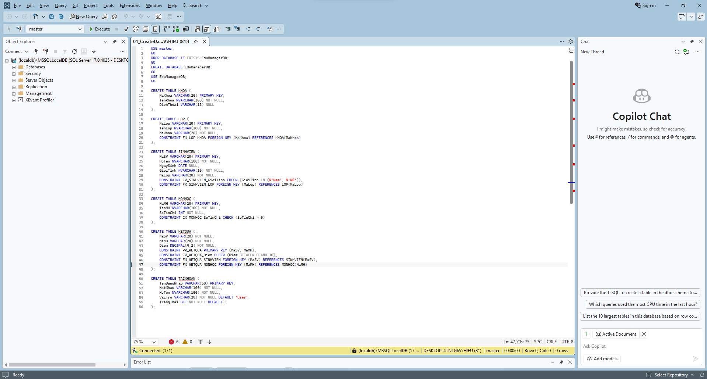
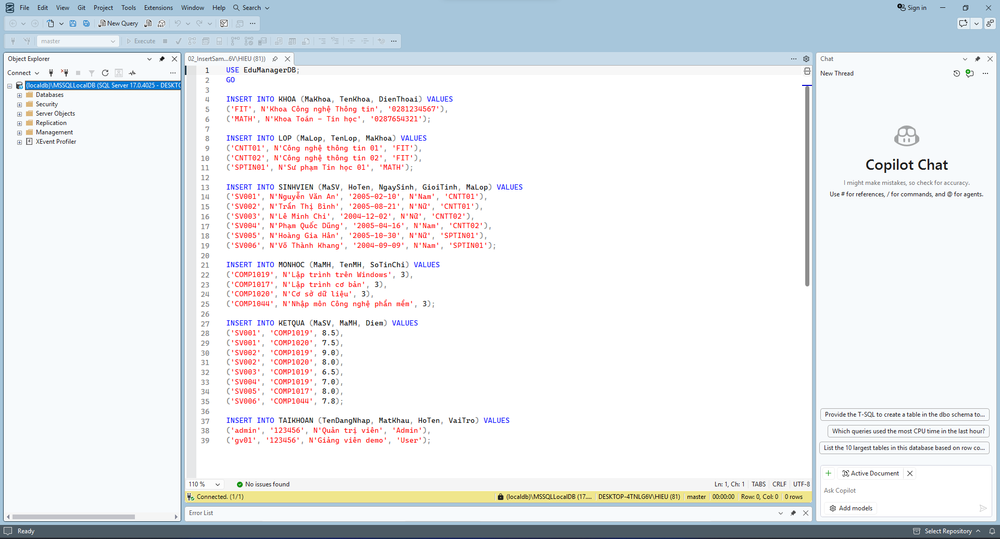
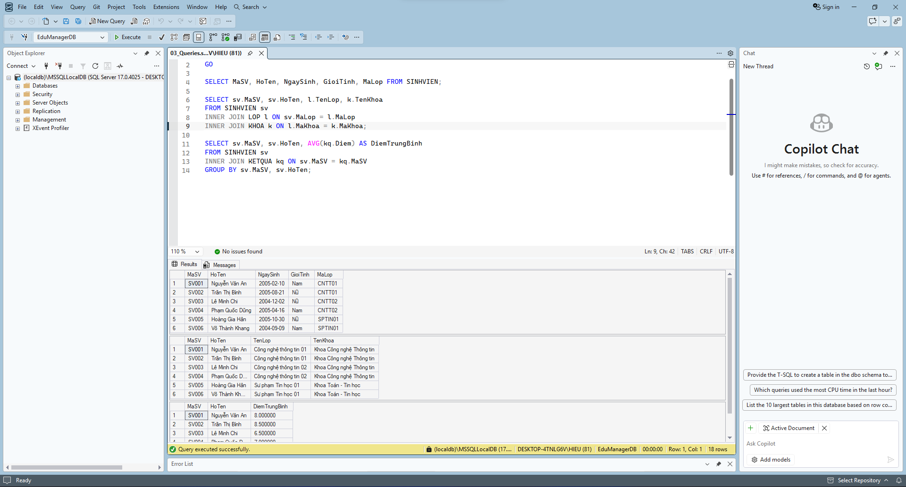

# Báo cáo Bài tập Cơ sở dữ liệu EduManagerDB

Tài liệu này giới thiệu tổng quan về các script T-SQL đã thực hiện cho bài toán thiết kế cơ sở dữ liệu quản lý sinh viên `EduManagerDB`, kèm theo các minh chứng chạy code thực tế.

## 1. Khởi tạo Cơ sở dữ liệu và Bảng (File: `01_CreateDatabase.sql`)
Script này thực hiện các công việc thiết lập ban đầu:
* Xóa database cũ (nếu có) và tạo mới database `EduManagerDB`.
* Tạo đầy đủ 6 bảng bắt buộc: **KHOA**, **LOP**, **SINHVIEN**, **MONHOC**, **KETQUA**, và **TAIKHOAN**.
* Thiết lập khóa chính và các khóa ngoại để liên kết các bảng một cách hợp lý.
* Áp dụng các ràng buộc toàn vẹn dữ liệu (CHECK constraints) bao gồm: 
  - Giới tính sinh viên chỉ nhận "Nam" hoặc "Nữ".
  - Số tín chỉ môn học phải lớn hơn 0.
  - Điểm số nằm trong khoảng từ 0 đến 10.

**Minh chứng chạy script tạo database và bảng:**

## 2. Nhập dữ liệu mẫu (File: `02_InsertSampleData.sql`)
Script này chịu trách nhiệm thêm dữ liệu demo vào hệ thống:
* Quá trình chèn dữ liệu tuân thủ nghiêm ngặt thứ tự các ràng buộc khóa ngoại (ví dụ: tạo KHOA trước khi tạo LOP, tạo LOP trước khi tạo SINHVIEN,...).
* Đảm bảo số lượng bản ghi mẫu đạt yêu cầu tối thiểu: 2 khoa, 3 lớp, 6 sinh viên, 4 môn học, 8 kết quả học tập và 2 tài khoản.

**Minh chứng chạy script nhập dữ liệu thành công không có lỗi:**

## 3. Thực thi Truy vấn (File: `03_Queries.sql`)
Script cuối cùng chứa các câu lệnh T-SQL để truy xuất và thống kê dữ liệu theo yêu cầu bài toán:
* Sử dụng `SELECT` cơ bản để lấy danh sách toàn bộ sinh viên.
* Sử dụng `INNER JOIN` liên kết các bảng SINHVIEN, LOP, và KHOA nhằm hiển thị thông tin sinh viên kèm theo tên lớp và tên khoa tương ứng.
* Kết hợp mệnh đề `GROUP BY` với hàm `AVG()` để tính điểm trung bình môn của từng sinh viên.

**Minh chứng kết quả bảng dữ liệu khi chạy truy vấn:**
