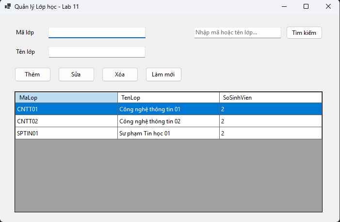
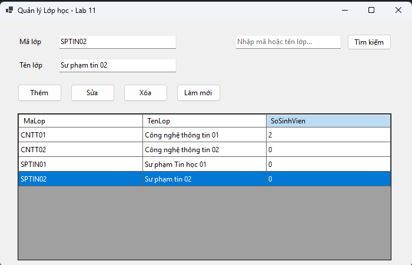
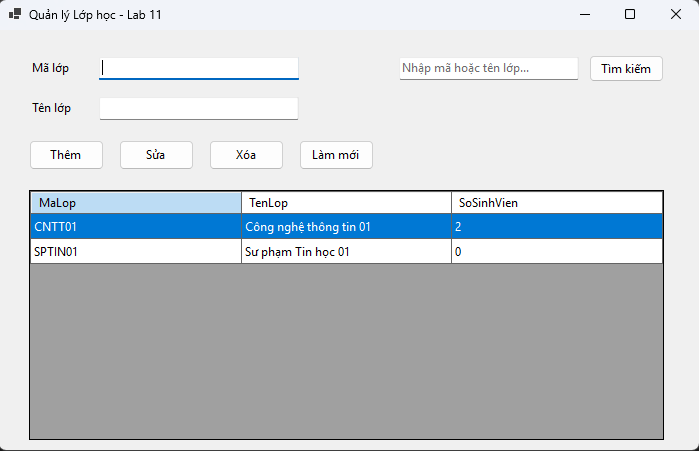
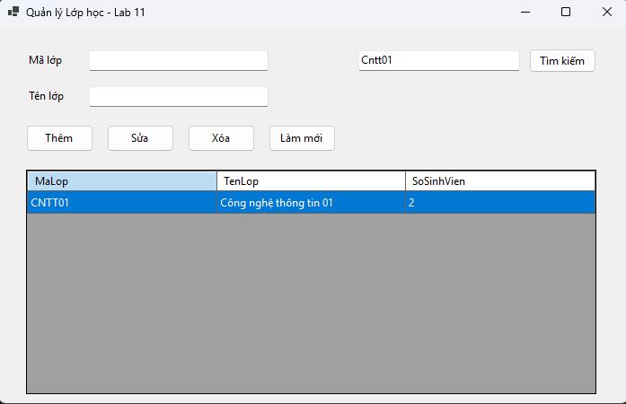

# Quản lý Lớp học - Lab 11

Đây là một ứng dụng Windows Forms cơ bản được xây dựng bằng C# và .NET 10, thực hiện các thao tác CRUD (Thêm, Đọc, Sửa, Xóa) trên cơ sở dữ liệu SQL Server. Ứng dụng giúp quản lý thông tin các Lớp học và thống kê số lượng sinh viên hiện có trong mỗi lớp.

## Tính năng chính
* **Hiển thị dữ liệu (Read):** Tải danh sách lớp học từ cơ sở dữ liệu `EduManagerDB`, kết hợp (JOIN) với bảng `SINHVIEN` để hiển thị cột "Số sinh viên".
* **Thêm mới (Create):** Thêm một lớp học mới vào cơ sở dữ liệu sau khi kiểm tra tính hợp lệ và đảm bảo mã lớp không bị trùng lặp.
* **Cập nhật (Update):** Cho phép sửa đổi tên lớp học dựa trên mã lớp đã chọn.
* **Xóa (Delete):** Xóa lớp học khỏi hệ thống. Có ràng buộc an toàn: Không cho phép xóa những lớp đang có sinh viên.
* **Tìm kiếm (Search):** Tìm kiếm thông tin lớp học theo "Mã lớp" hoặc "Tên lớp" bằng từ khóa.
* **Làm mới (Refresh):** Xóa trắng các ô nhập liệu và tải lại danh sách dữ liệu ban đầu.

## Công nghệ sử dụng
* **Ngôn ngữ:** C# 
* **Framework:** .NET 10.0 (Windows Forms)
* **Thư viện kết nối CSDL:** `Microsoft.Data.SqlClient` (v7.1.1)
* **Cơ sở dữ liệu:** SQL Server LocalDB (`(localdb)\MSSQLLocalDB`)

## Hướng dẫn cài đặt và sử dụng
1. Clone hoặc tải mã nguồn về máy.
2. Đảm bảo bạn đã cài đặt SQL Server LocalDB và tạo cơ sở dữ liệu tên `EduManagerDB` gồm 2 bảng `LOP(MaLop, TenLop)` và `SINHVIEN(MaSV, MaLop, ...)`.
3. Mở file `lab11.csproj` bằng Visual Studio.
4. Chạy dự án (Bấm `F5` hoặc `Ctrl + F5`).

## Minh chứng hoạt động (Screenshots)

Dưới đây là các hình ảnh minh chứng cho quá trình hoạt động của ứng dụng:

### 1. Giao diện chính và hiển thị danh sách

### 2. Thao tác Thêm/Sửa lớp học

### 3. Thao tác Xóa lớp học

### 4. Thao tác Tìm kiếm lớp học
