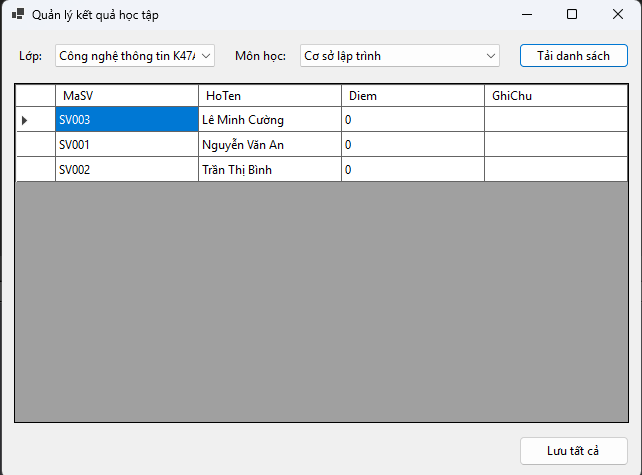
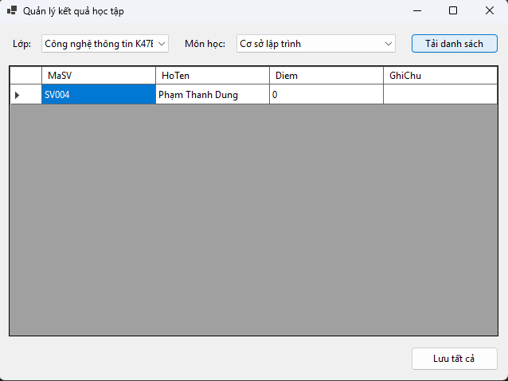
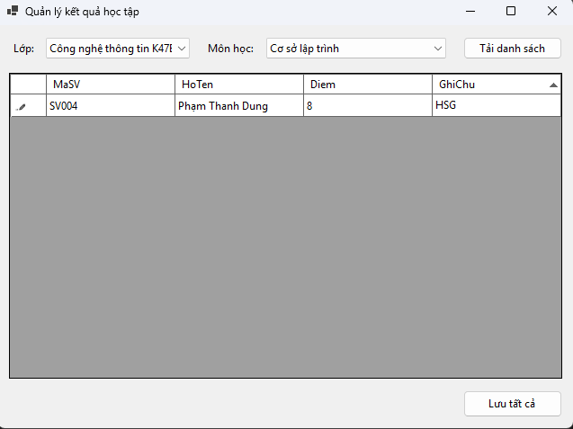

# Quản lý Kết quả Học tập - Lab 12

Đây là một ứng dụng Windows Forms được xây dựng bằng C# và .NET 10, tập trung vào nghiệp vụ quản lý điểm số của sinh viên. Ứng dụng cho phép người dùng (giảng viên/giáo vụ) tải danh sách sinh viên theo từng lớp và môn học cụ thể để tiến hành nhập điểm, ghi chú và lưu trữ hàng loạt vào cơ sở dữ liệu SQL Server.

## Tính năng chính

* **Lọc dữ liệu thông minh:** Lựa chọn "Lớp" và "Môn học" từ danh sách thả xuống (ComboBox) để xác định đúng danh sách sinh viên cần nhập điểm.
* **Tải danh sách:** Nút "Tải danh sách" sẽ truy xuất và hiển thị toàn bộ sinh viên thuộc lớp đã chọn lên lưới dữ liệu (DataGridView) với các thông tin: Mã sinh viên, Họ tên, Điểm và Ghi chú.
* **Cập nhật điểm trực tiếp:** Cho phép người dùng nhập hoặc chỉnh sửa "Điểm" và "Ghi chú" trực tiếp ngay trên các ô của lưới dữ liệu một cách trực quan, nhanh chóng.
* **Lưu hàng loạt (Batch Save):** Nút "Lưu tất cả" giúp ghi nhận và cập nhật toàn bộ những thay đổi về điểm số và ghi chú của tất cả sinh viên trên lưới xuống cơ sở dữ liệu chỉ trong một lần bấm.

## Công nghệ sử dụng

* **Ngôn ngữ:** C#
* **Framework:** .NET 10.0 (Windows Forms)
* **Thư viện kết nối CSDL:** `Microsoft.Data.SqlClient` và `System.Data.SqlClient`
* **Giao diện:** Kiến trúc Form nhập điểm đa năng (`FrmNhapDiemTheoLop`)

## Hướng dẫn sử dụng

1. Mở ứng dụng, chọn **Lớp** (ví dụ: Công nghệ thông tin K47) và **Môn học** (ví dụ: Cơ sở lập trình) tương ứng.
2. Nhấn nút **Tải danh sách** để hiển thị danh sách sinh viên của lớp đó.
3. Tiến hành click vào cột *Diem* và *GhiChu* trên lưới để nhập dữ liệu trực tiếp.
4. Sau khi hoàn tất việc nhập điểm cho danh sách, nhấn nút **Lưu tất cả** để cập nhật toàn bộ dữ liệu vào hệ thống.

## Minh chứng hoạt động (Screenshots)

Dưới đây là các hình ảnh minh chứng cho quá trình hoạt động của ứng dụng:

### 1. Giao diện tải danh sách sinh viên theo lớp và môn học

### 2. Giao diện hiển thị danh sách sinh viên của một lớp khác

### 3. Giao diện sau khi tiến hành nhập điểm, ghi chú và chuẩn bị lưu
